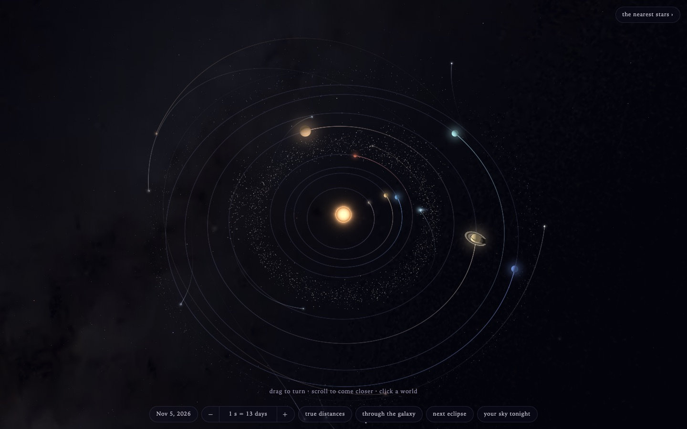

# Solar System

The Sun, its planets and their larger moons where they really are today,
drawn in one HTML file with raw WebGL. No build, no dependencies, no network.

**Run it:** open `index.html` in a browser. (Or serve the folder, e.g.
`python3 -m http.server`, and open `http://localhost:8000`; that is needed
only for "your sky tonight" to ask for your location.)

Drag to turn, pinch or scroll to zoom, tap a body for its name, double-tap
to go there. Tap the date to come back to today. The pills change the pace
of time, show true distances, fly out through the galaxy, find the next
eclipse, visit the nearest stars, and stand you on the Earth to see
tonight's sky.

## What is real in it

- Planets from JPL's Keplerian elements (within 0.32° of JPL Horizons, 1990–2062).
- The Moon from the lunar theory in Meeus, *Astronomical Algorithms* (0.015°).
- 19 other moons fitted to Horizons; IAU spin axes, so day and night,
  Saturn's ring tilt and Uranus on its side are true.
- 3,249 stars of the Yale Bright Star Catalogue, with their distances.
- Public-domain NASA and USGS maps for Earth, the Moon, Mars, Mercury,
  Jupiter, Pluto and Jupiter's four large moons. Venus, Saturn, Uranus and
  Neptune are painted by the shaders.

Where each piece of data comes from is in [CREDITS.md](CREDITS.md).

## URL options

`?lang=es` Spanish · `?gl=0` the 2D fallback · `?date=2027-08-02` another day ·
`?sky=1&lat=29.76&lon=-95.37` start on the ground at a place

## Rebuilding the data

The star catalogue, maps and moon orbits inside the page are generated by
`tools/solar_data.py` (Python 3, needs Pillow). It downloads every source
(about 700 MB the first time) and writes the data blocks back into the page:

    python3 tools/solar_data.py build index.html
    python3 tools/solar_data.py check index.html

## Licence

The code is under the [MIT licence](LICENSE). The maps and star data packed
inside the page keep their own terms (public domain, or free with credit);
see [CREDITS.md](CREDITS.md).

Made by w00l23, with help from Claude (Anthropic).
